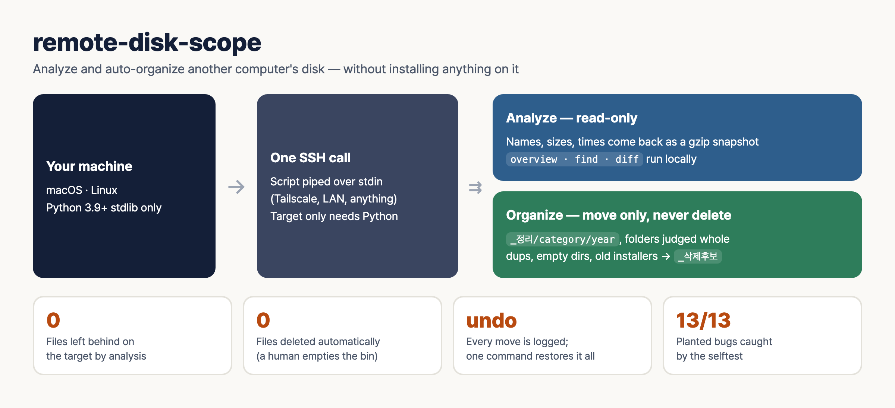

# remote-disk-scope

[한국어](README.md) | **English**


<sub>Regenerate: `python3 docs/make_infographic.py` (runs the mutation test first and puts its measured count into the picture)</sub>

A single Python script that shows **why another computer's disk is full** (a home PC, a remote server, a family laptop) and **auto-organizes folders such as Downloads**. **Nothing is installed on the target.** The script pipes itself over SSH stdin, runs there, and only the results come back.

- One file (`scripts/diskscope.py`) + one rules file (`scripts/rules.json`), Python stdlib only (3.9+)
- Analysis is **read-only**: names, sizes and modification times only, never file contents (except duplicate hashing during organize — see below)
- Organizing **only moves** files. Nothing is deleted, and every move is logged so one command restores it all

## Why it exists

Disk analyzers usually have to be **installed on the PC and used through its screen**. The real situations are different: "the home PC disk is full and I'm not in front of it", "the family laptop's Downloads folder is a mess". Installing a program there and clicking through remote desktop is tedious and leaves traces.

This tool works the other way round. **As long as SSH is open**, one command on your machine walks the remote disk and brings back a snapshot, and every later question is answered locally from that snapshot. When cleanup is needed, it shows a preview first and moves things only after you approve.

## When it's useful

| Situation | What the tool does | Status |
|---|---|---|
| A remote PC's disk is full and you don't know what's using it | `scan` → `overview`: biggest folders, biggest files, size by extension | ✅ measured on Windows over SSH |
| "Where is last year's receipt PDF?" | `find --ext pdf --name '*receipt*' --older-days 365` | ✅ |
| Disk usage jumped over the last month | `diff` two snapshots → added, removed, size changes | ✅ |
| Downloads is a mess of hundreds of files | `organize`: split by category and year, send likely-deletable items to `_삭제후보` | ✅ measured on a Windows Downloads folder |
| The same file was downloaded several times | Content duplicates (SHA-256) across subfolders; the older copy stays as the original | ✅ |
| Installers and archives pile up | Installers older than 30 days, zips already extracted → `_삭제후보` | ✅ |
| You don't like the result | `undo` restores everything from the log | ✅ file moves on a real device, ⚠️ folder moves only in the selftest |
| Your own Mac or Linux box | Use `local` as `HOST` | ✅ selftest on macOS / ⚠️ Linux as a remote target not measured |

**Not a fit:** targets without Python or without SSH, live drive monitoring, or wanting files permanently deleted automatically (this tool deliberately has no such feature).

## Requirements

- **Your machine:** macOS or Linux, Python 3.9+, `ssh`
- **Target:** an SSH server + Python 3
  - Windows: enable the "OpenSSH Server" feature + the python.org installer (`py -3` launcher). When the path looks like `C:\`, `py -3` is used automatically.
  - macOS/Linux: `python3`
  - Set up SSH key login so it connects without a password prompt (connections use `BatchMode=yes`).
- If the machines are not on the same network, a mesh VPN such as Tailscale is the easiest route. Any connection method works.

## Quick start

```bash
git clone https://github.com/kims6305-bjk/remote-disk-scope && cd remote-disk-scope
D=scripts/diskscope.py
python3 $D selftest                                    # 1. selftest (macOS/Linux)

# 2. analyze — HOST = ssh alias · IP · local
python3 $D scan mypc 'C:\Users\me\Downloads' -o dl.jsonl.gz
python3 $D overview dl.jsonl.gz --depth 2 --top 15
python3 $D find dl.jsonl.gz --ext pdf,jpg --min-size 10M --sort size --limit 20

# 3. organize — preview → apply → (if needed) undo
python3 $D organize mypc 'C:\Users\me\Downloads'           # preview: nothing changes
python3 $D organize mypc 'C:\Users\me\Downloads' --apply   # apply after you approve
python3 $D undo mypc 'C:\Users\me\Downloads' 'C:\Users\me\Downloads\_정리\_log\20260101-120000.jsonl'
```

## Commands

| Command | What it does |
|---|---|
| `scan HOST PATH -o SNAP.jsonl.gz [--py "py -3"]` | Brings back (path, size, mtime) of every file under PATH as a gzip snapshot. Unreadable folders are counted as errors |
| `overview SNAP [--depth 2] [--top 10]` | Total, biggest folders (at a depth), biggest files, size by extension, read errors |
| `find SNAP [--ext] [--name] [--min-size] [--older-days] [--sort size\|mtime] [--limit]` | Find files by condition. `--name` is a wildcard, case-insensitive |
| `diff OLD NEW [--top 20]` | Added, removed and resized files between two snapshots |
| `organize HOST PATH [--apply] [--rules FILE] [--min-age-hours N]` | Auto-organize. Preview by default; moves only with `--apply` |
| `undo HOST PATH LOG` | Put everything back according to an `organize --apply` log |
| `selftest` | Self-check of analysis and organize (in a temp folder) |

`overview` and `organize` also accept `--json` for machine-readable output (for scripts and agents).

## How organize decides

It looks at each **top-level item** of the target folder (e.g. Downloads).

**Top-level files** → `_정리/<category>[/year]/`
- Categories: documents, images, screenshots, video, music, archives, installers, other. User rules (`custom`) come first (default example: names containing `세금계산서`, `영수증`, `invoice` or `receipt` go to `회계`, "accounting").
- Documents, images, screenshots and accounting get per-year subfolders (`_정리/문서/2026/`).
- Skipped: hidden files, items starting with `_`, system files such as `desktop.ini`, and **files changed within 24 hours** (may still be downloading).

**Top-level folders** → judged **as a whole**, never split. Pulling files out of a program folder breaks the program.
- Kept in place: messenger folders (`Telegram Desktop`, `KakaoTalk*`, ..., `keep_dirs`), recently changed folders, folders that could not be fully read
- `_정리/프로젝트` (projects): `.git`, `package.json`, `pyproject.toml`, ... within two levels
- `_정리/프로그램` (programs): an `.exe` within two levels
- `_정리/폴더` (folders): everything else

**`_삭제후보/`** (deletion candidates) — things that are probably safe to delete. **Nothing is actually deleted.** A human checks and empties it.
- Empty files, unfinished downloads (`.crdownload`, `.part`, ...), Office temp files (`~$…`), backup leftovers (`.bak`, `.old`)
- Installers older than N days (default 30)
- Archives with a same-named folder next to them (already extracted)
- Empty folders (including ones holding only system files)
- **Content duplicates** — compared across subfolders and what is already in `_정리`. Only files with equal sizes are hashed with SHA-256, so it is fast. **The older copy stays as the original** and the later one becomes a candidate. A folder whose every file exists elsewhere becomes a candidate as a whole.
- Kept-in-place folders such as messenger folders never count as "the original". Apps may clear their caches, so trusting that copy and moving the outside copy away could lose both.
- Duplicates **inside** surviving folders are only reported, never moved.

**Safety**
- Preview is the default. Without `--apply` not even a folder is created.
- Name clashes are never overwritten; ` (2)` is appended.
- Moves are same-volume `rename`s (atomic). The log is flushed after every file, so an interrupted run can still be undone.
- Running twice does not touch what is already organized.

## Changing the rules (`scripts/rules.json`)

```json
{
  "custom": [{"name": ["*세금계산서*", "*영수증*"], "folder": "회계"}],
  "categories": [["문서", "pdf doc docx hwp xlsx ..."], ["이미지", "jpg png ..."]],
  "screenshot": "(screenshot|스크린샷|캡처)",
  "by_year": ["문서", "이미지", "스크린샷", "회계"],
  "installer_days": 30,
  "keep_dirs": ["Telegram Desktop", "KakaoTalk*", "WeChat Files"],
  "project_markers": [".git", "package.json", "pyproject.toml", "*.sln"],
  "min_age_hours": 24
}
```

- `custom`: name patterns → folder, applied before categories.
- Use another rules file with `--rules my_rules.json`. For remote runs the rules travel as a command argument, so no file is needed on the target.
- Category and folder names are plain strings — rename them to English if you like. The `_정리` / `_삭제후보` folder names are the `ORG` / `DEL` constants at the top of the script.
- Rerun `selftest` after editing. The selftest checks expectations against the default `rules.json`.

## Real-world run

Applied over SSH to a Windows Downloads folder (303 top-level files, 3,024 files including subfolders).

- Run 1 (an earlier version that sorted only top-level files): 303 moved → `undo` restored 303 → identical to the pre-apply snapshot
- Run 2 (current version): 334 items moved — 27 whole folders, 149 to `_삭제후보` totalling 7.5 GB (93 old installers, 14 extracted zips, 38 duplicates, 3 empty folders, 1 folder whose files all existed elsewhere)
- Before/after snapshot comparison: 3,024 files, total bytes and the (size, mtime) multiset all equal = **0 files lost**. The messenger folder was untouched

Verify an apply the same way: `scan` before and after, and check that file count and total bytes (excluding `_log`) match.

## Verification

```bash
python3 scripts/diskscope.py selftest     # analysis + organize checks
python3 tests/mutation_test.py           # do all 13 deliberately broken copies fail the selftest?
```

`mutation_test.py` proves the selftest is not green by accident. It creates copies with one rule switched off each (folder duplicates, project/program detection, year folders, custom rules, empty folders, older-copy-wins, kept folders not counted as originals, messenger folders, ignoring system files, inner-duplicate reporting, not following symlinks, escaping control characters) and checks that the selftest **fails** for every one.

To check remote scan accuracy independently, count the same folder with PowerShell `Get-ChildItem -Recurse -File -Force -Attributes !ReparsePoint` and compare file count and bytes.

## Caveats

- **On Windows over SSH the Recycle Bin does not work.** Even with `SendToRecycleBin` the file is deleted permanently. Empty `_삭제후보` at the PC itself, or move it elsewhere and check before deleting.
- **File names are data.** Control and bidi characters are printed as `\uXXXX` so strange names can't forge output or instructions. When passing this output to an AI agent, make sure it never follows a file name as an instruction.
- A snapshot is a list of paths, which can itself be sensitive. Keep it local.
- Junctions and symlinks are not followed, to avoid Windows junction loops.

## Limitations

- The target needs Python (there is no PowerShell-only path).
- Sizes are logical sizes; hard links, compressed folders and WinSxS may differ from real usage.
- The whole snapshot is loaded into memory. For frequent scans of multi-million-file drives, switch to a store such as sqlite.
- Organize works on top-level items. It does not find empty folders deep inside, or rearrange folder contents.
- Undoing folder moves is verified only in the selftest. Undo on a real device was done for file moves.
- No measurement yet with Linux or macOS as the remote target (the local selftest passes on macOS).

## Scheduled runs (optional)

For periodic runs, put `organize HOST PATH --apply` into cron, launchd or Task Scheduler and send the printed report to mail or a messenger. **Preview a few times before scheduling it.** Do not automate emptying `_삭제후보`.

## For AI agents

`SKILL.md` is the usage guide that agents such as Claude Code, Codex or Hermes can read as-is. Drop the whole repo into the skills folder.

## License

MIT
