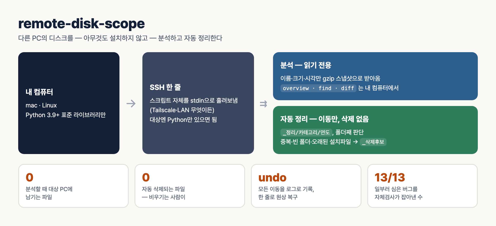

# remote-disk-scope

**한국어** | [English](README.en.md)


<sub>그림 재생성: `python3 docs/make_infographic.py` (변이 검사를 먼저 돌려 그 결과 숫자를 그림에 넣는다)</sub>

다른 컴퓨터(집 PC, 원격 서버, 가족 노트북)의 디스크가 **왜 찼는지 보고, 다운로드 폴더 같은 곳을 자동으로 정리**하는 파이썬 스크립트 하나입니다. 대상 컴퓨터에는 **아무것도 설치하지 않습니다.** 스크립트 자신을 SSH 표준입력으로 흘려보내 실행하고, 결과만 받아옵니다.

- 파일 하나(`scripts/diskscope.py`) + 규칙 파일 하나(`scripts/rules.json`), 파이썬 표준 라이브러리만 사용 (3.9+)
- 분석은 **읽기 전용**: 이름·크기·수정시각만 읽고, 파일 내용은 읽지 않습니다 (정리 시 중복 비교는 예외 — 아래 참고)
- 정리는 **이동만** 합니다. 지우지 않고, 모든 이동은 로그로 남아 한 줄로 되돌릴 수 있습니다

## 왜 만들었나

원격 PC 디스크 분석기는 대개 **그 PC에 설치해서 화면을 보며 쓰는** 프로그램입니다. 그런데 실제로 필요한 상황은 "집 PC 디스크가 꽉 찼다는데 지금 그 앞에 없다", "가족 노트북 다운로드 폴더가 엉망이다" 같은 경우입니다. 그 PC에 프로그램을 깔고, 원격 데스크톱으로 들어가 클릭하는 것은 번거롭고 흔적도 남습니다.

이 도구는 반대로 접근합니다. **SSH만 열려 있으면**, 내 컴퓨터에서 명령 한 줄로 원격 디스크를 훑어 스냅샷을 받아오고, 이후 질문은 전부 내 컴퓨터에서 그 스냅샷으로 답합니다. 정리가 필요하면 미리보기를 먼저 보여주고, 승인한 뒤에만 실제로 옮깁니다.

## 언제 유용한가

| 이럴 때 | 도구로 하는 일 | 상태 |
|---|---|---|
| 원격 PC 디스크가 꽉 찼는데 무엇이 차지하는지 모를 때 | `scan` → `overview`로 큰 폴더·큰 파일·확장자별 용량 | ✅ Windows 원격(SSH) 실측 |
| "작년 영수증 PDF 어디 있더라" | `find --ext pdf --name '*영수증*' --older-days 365` | ✅ |
| 한 달 사이 디스크가 갑자기 늘었을 때 | 스냅샷 두 개를 `diff` → 추가·삭제·크기 변화 | ✅ |
| 다운로드 폴더가 수백 개 파일로 엉망일 때 | `organize`: 카테고리·연도별로 나누고, 지워도 될 것은 `_삭제후보`로 | ✅ Windows 다운로드 폴더 실측 |
| 같은 파일을 여러 번 받아 용량이 새고 있을 때 | 하위폴더까지 내용(SHA-256)으로 중복 판정, 오래된 쪽을 원본으로 남김 | ✅ |
| 설치파일·압축파일이 쌓여 있을 때 | 30일 지난 설치파일, 이미 압축을 푼 zip → `_삭제후보` | ✅ |
| 정리했는데 마음에 안 들 때 | `undo`로 로그대로 원상 복구 | ✅ 파일 단위 실기기, ⚠️ 폴더 단위는 자체검사만 |
| 맥·리눅스 자기 자신 | `HOST`에 `local` | ✅ 맥 자체검사 / ⚠️ 리눅스 원격 미실측 |

**안 맞는 경우:** 대상에 파이썬이 없거나 SSH를 열 수 없는 PC, 드라이브 단위 실시간 모니터링, 파일을 자동으로 영구 삭제하고 싶은 경우(이 도구는 일부러 그 기능이 없습니다).

## 준비물

- **내 컴퓨터:** macOS 또는 Linux, Python 3.9+, `ssh`
- **대상 컴퓨터:** SSH 서버 + Python 3
  - Windows: "OpenSSH 서버" 기능 켜기 + python.org 설치판(`py -3` 런처). 경로가 `C:\`처럼 시작하면 자동으로 `py -3`을 씁니다.
  - macOS/Linux: `python3`
  - 비밀번호 입력 없이 접속되도록 SSH 키 로그인을 미리 설정합니다 (`BatchMode=yes`로 접속).
- 같은 네트워크가 아니면 Tailscale 같은 메시 VPN이 가장 간단합니다. 접속 방식은 상관없습니다.

## 빠른 시작

```bash
git clone https://github.com/kims6305-bjk/remote-disk-scope && cd remote-disk-scope
D=scripts/diskscope.py
python3 $D selftest                                    # 1. 자체검사 (맥/리눅스)

# 2. 분석 — HOST = ssh 별칭 · IP · local
python3 $D scan mypc 'C:\Users\me\Downloads' -o dl.jsonl.gz
python3 $D overview dl.jsonl.gz --depth 2 --top 15
python3 $D find dl.jsonl.gz --ext pdf,jpg --min-size 10M --sort size --limit 20

# 3. 정리 — 미리보기 → 적용 → (필요하면) 되돌리기
python3 $D organize mypc 'C:\Users\me\Downloads'           # 미리보기: 아무것도 안 바뀜
python3 $D organize mypc 'C:\Users\me\Downloads' --apply   # 승인 후 적용
python3 $D undo mypc 'C:\Users\me\Downloads' 'C:\Users\me\Downloads\_정리\_log\20260101-120000.jsonl'
```

## 명령

| 명령 | 하는 일 |
|---|---|
| `scan HOST PATH -o SNAP.jsonl.gz [--py "py -3"]` | PATH 아래 모든 파일의 (경로, 크기, 수정시각)을 gzip 스냅샷으로 받아옴. 읽지 못한 폴더는 오류로 집계 |
| `overview SNAP [--depth 2] [--top 10]` | 총량, 큰 폴더(지정 깊이), 큰 파일, 확장자별 용량, 읽기 실패 |
| `find SNAP [--ext] [--name] [--min-size] [--older-days] [--sort size\|mtime] [--limit]` | 조건으로 파일 찾기. `--name`은 와일드카드, 대소문자 무시 |
| `diff OLD NEW [--top 20]` | 두 스냅샷 사이 추가·삭제·크기 변화 |
| `organize HOST PATH [--apply] [--rules FILE] [--min-age-hours N]` | 자동 정리. 기본은 미리보기, `--apply`일 때만 이동 |
| `undo HOST PATH LOG` | `organize --apply` 로그대로 원위치 |
| `selftest` | 분석·정리 전 기능 자체검사 (임시 폴더에서) |

`overview`와 `organize`는 `--json`으로 기계가 읽을 출력도 냅니다 (스크립트·에이전트 연동용).

## 자동 정리는 이렇게 판단합니다

정리 대상 폴더(예: 다운로드)의 **최상위 항목**을 하나씩 봅니다.

**최상위 파일** → `_정리/<카테고리>[/연도]/`
- 카테고리: 문서, 이미지, 스크린샷, 영상, 음악, 압축, 설치파일, 기타. 사용자 규칙(`custom`)이 먼저 적용됩니다 (기본 예시: 이름에 `세금계산서`·`영수증`·`invoice`·`receipt`가 있으면 `회계`).
- 문서·이미지·스크린샷·회계는 수정 연도별 하위폴더(`_정리/문서/2026/`)까지 만듭니다.
- 건너뛰는 것: 숨김 파일, `_`로 시작하는 항목, `desktop.ini` 같은 시스템 파일, **24시간 안에 바뀐 파일**(아직 받는 중일 수 있음).

**최상위 폴더** → 안을 쪼개지 않고 **폴더째** 판단합니다. 프로그램 폴더 안의 파일을 꺼내면 프로그램이 깨지기 때문입니다.
- 그대로 둠: 메신저 폴더(`Telegram Desktop`, `KakaoTalk*` 등, `keep_dirs`), 최근 바뀐 폴더, 일부를 읽지 못한 폴더
- `_정리/프로젝트`: 2단계 안에 `.git`, `package.json`, `pyproject.toml` 등이 있는 폴더
- `_정리/프로그램`: 2단계 안에 `.exe`가 있는 폴더
- `_정리/폴더`: 나머지

**`_삭제후보/`** — 지워도 될 가능성이 높은 것. **실제로 지우지 않습니다.** 내용을 확인하고 비우는 것은 사람의 몫입니다.
- 빈 파일, 미완성 다운로드(`.crdownload`, `.part` 등), Office 임시파일(`~$…`), 백업 잔여(`.bak`, `.old`)
- N일(기본 30) 지난 설치파일
- 같은 이름 폴더가 옆에 있는 압축파일 (이미 압축을 풀었다는 뜻)
- 빈 폴더 (시스템 파일만 있는 경우 포함)
- **내용이 같은 중복** — 하위폴더와 이미 정리된 `_정리` 안까지 비교합니다. 크기가 같은 파일만 SHA-256으로 비교하므로 빠릅니다. **오래된 쪽을 원본으로 남기고** 나중 것을 후보로 보냅니다. 모든 파일이 다른 곳에도 있는 폴더는 폴더째 후보가 됩니다.
- 메신저 폴더처럼 그대로 두는 폴더는 "원본"으로 치지 않습니다. 앱이 캐시를 자동으로 비울 수 있어서, 그쪽을 믿고 바깥 사본을 후보로 보내면 둘 다 잃을 수 있기 때문입니다.
- 남는 폴더 **안**의 중복은 목록으로 보고만 하고 옮기지 않습니다.

**안전장치**
- 미리보기가 기본입니다. `--apply`가 없으면 폴더 하나도 만들지 않습니다.
- 같은 이름이 있으면 덮어쓰지 않고 ` (2)`를 붙입니다.
- 이동은 같은 볼륨 안의 `rename`이라 원자적입니다. 파일마다 로그를 즉시 기록하므로 중간에 끊겨도 되돌릴 수 있습니다.
- 두 번 실행해도 이미 정리된 것은 다시 건드리지 않습니다.

## 규칙 바꾸기 (`scripts/rules.json`)

```json
{
  "custom": [{"name": ["*세금계산서*", "*영수증*"], "folder": "회계"}],
  "categories": [["문서", "pdf doc docx hwp xlsx ..."], ["이미지", "jpg png ..."]],
  "screenshot": "(screenshot|스크린샷|캡처)",
  "by_year": ["문서", "이미지", "스크린샷", "회계"],
  "installer_days": 30,
  "keep_dirs": ["Telegram Desktop", "KakaoTalk*", "WeChat Files"],
  "project_markers": [".git", "package.json", "pyproject.toml", "*.sln"],
  "min_age_hours": 24
}
```

- `custom`: 이름 패턴 → 폴더. 카테고리보다 먼저 적용됩니다.
- 다른 규칙 파일을 쓰려면 `--rules my_rules.json`. 원격 실행 시 규칙은 명령 인자로 함께 전달되므로 대상에 파일을 둘 필요가 없습니다.
- 카테고리·폴더 이름은 그냥 문자열이라 원하는 이름(영어 등)으로 바꿔도 됩니다. `_정리`·`_삭제후보` 폴더 이름은 스크립트 상단 `ORG`, `DEL` 상수입니다.
- 규칙을 고친 뒤에는 `selftest`를 다시 돌리세요. selftest는 기본 `rules.json`을 기준으로 기대값을 검사합니다.

## 실제로 써본 결과

Windows PC의 다운로드 폴더(최상위 파일 303개, 하위폴더 포함 3,024개 파일)에 SSH로 적용했습니다.

- 1차(최상위 파일만 정리하던 버전): 303개 이동 → `undo`로 303개 복원 → 적용 전 스냅샷과 완전히 동일
- 2차(현재 버전): 334개 이동 — 폴더째 27개, `_삭제후보` 149개 7.5GB (오래된 설치파일 93개, 압축 푼 zip 14개, 중복 38개, 빈 폴더 3개, 전부 다른 곳에 있는 폴더 1개)
- 적용 전후 스냅샷 대조: 파일 3,024개, 총 바이트, (크기·수정시각) 다중집합이 모두 같음 = **사라진 파일 0**. 메신저 폴더는 그대로

적용 후 검증은 이렇게 합니다: 적용 전후로 `scan`을 한 번씩 하고, `_log`를 뺀 파일 수·총 바이트가 같은지 확인합니다.

## 검증

```bash
python3 scripts/diskscope.py selftest     # 분석 + 정리 기능 검사
python3 tests/mutation_test.py           # 일부러 버그를 심은 사본 13종이 전부 selftest에 걸리는지
```

`mutation_test.py`는 "자체검사가 우연히 초록불인 것이 아님"을 증명합니다. 규칙 하나씩(폴더 중복 판정, 프로젝트·프로그램 감지, 연도 폴더, 사용자 규칙, 빈 폴더, 오래된 쪽 원본, 유지 폴더 원본 제외, 메신저 폴더, 시스템 파일 무시, 폴더 안 중복 표시, 심볼릭 링크 미추적, 제어문자 이스케이프)을 끈 사본을 만들어 selftest가 **실패하는지** 확인합니다.

원격 스캔의 정확도를 따로 확인하고 싶다면, 같은 폴더를 PowerShell `Get-ChildItem -Recurse -File -Force -Attributes !ReparsePoint`로 세어 파일 수·바이트를 비교하면 됩니다.

## 주의할 점

- **SSH 세션의 Windows에서는 휴지통이 동작하지 않습니다.** `SendToRecycleBin` 옵션을 줘도 영구 삭제가 됩니다. `_삭제후보`를 비울 때는 직접 그 PC에서 하거나, 별도 폴더로 옮긴 뒤 확인하고 지우세요.
- **파일 이름은 데이터입니다.** 출력할 때 제어문자·방향 전환 문자는 `\uXXXX`로 바꿔, 이상한 파일명이 출력이나 지시문을 위조하지 못하게 합니다. 이 출력을 AI 에이전트에게 넘길 때도 파일명을 지시로 따르지 않게 하세요.
- 스냅샷에는 경로 목록이 들어 있으므로 그 자체가 민감정보일 수 있습니다. 공유하지 말고 로컬에 두세요.
- 정션·심볼릭 링크는 따라가지 않습니다. Windows 정션 루프에 빠지지 않게 하기 위해서입니다.

## 한계

- 대상에 파이썬이 있어야 합니다. (PowerShell만으로 도는 경로는 없음)
- 크기는 논리 크기입니다. 하드링크·압축 폴더·WinSxS의 실제 점유량과 다를 수 있습니다.
- 스냅샷 전체를 메모리에 올립니다. 수백만 파일 드라이브 전체를 자주 스캔한다면 sqlite 같은 저장소로 바꾸는 편이 낫습니다.
- 정리는 최상위 항목 단위입니다. 깊은 하위폴더 안의 빈 폴더나 폴더 내부 재배치는 하지 않습니다.
- 폴더 이동의 되돌리기는 자체검사로만 확인했습니다. 실제 기기에서 되돌린 건 파일 단위 정리입니다.
- 리눅스·맥을 원격 대상으로 한 실측은 아직 없습니다 (로컬 자체검사는 맥에서 통과).

## 자동 실행 (선택)

주기 실행이 필요하면 cron·launchd·작업 스케줄러에 `organize HOST PATH --apply`를 걸고 출력(보고서)을 메일·메신저로 받으면 됩니다. **처음에는 몇 번 미리보기로 결과를 확인한 뒤에** 거는 것을 권합니다. `_삭제후보`를 비우는 것은 자동화하지 마세요.

## AI 에이전트용

`SKILL.md`는 Claude Code·Codex·Hermes 같은 에이전트가 그대로 읽고 쓰는 사용 지침입니다. 스킬 폴더에 이 레포를 통째로 두면 됩니다.

## 라이선스

MIT
